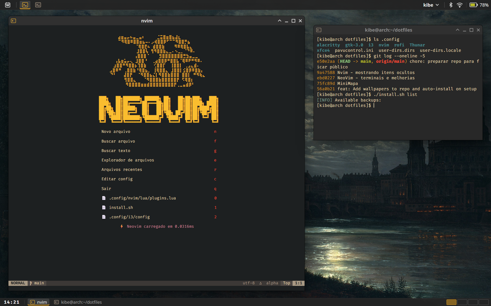

# dotfiles

Configurações pessoais de desktop Linux: **Arch Linux + XFCE + i3** e **Hyprland** (em construção), com Neovim, Kitty e Rofi. Cada ambiente fica numa pasta própria e é linkado no `$HOME` com **GNU Stow**.



<sub>Prévia renderizada a partir das configs deste repositório (cores, fontes, dashboard e painéis).</sub>

## Instalação rápida

```bash
git clone https://github.com/1Kibe/dotfiles.git ~/dotfiles
cd ~/dotfiles
./install.sh
```

O script detecta a distro, pergunta quais ambientes ativar (`xfce` e `hyprland` já vêm marcados), instala os pacotes, pergunta se liga o servidor SSH (padrão: não) e cria os links. Rode como usuário normal: ele chama o `sudo` quando precisa.

No Arch, a instalação começa com `pacman -Syu`: o sistema inteiro é atualizado junto, o que evita erro 404 nos mirrors e atualização parcial quando o script roda de novo semanas depois.

Para rodar sem nenhuma pergunta, usando os padrões (ambientes `xfce` e `hyprland`, SSH não, dependências opcionais puladas), use `--yes`. Serve para testes repetidos numa VM a partir de um snapshot:

```bash
./install.sh --yes
```

Pode clonar em qualquer pasta, por exemplo `~/Projetos/dotfiles`. Só não mova a pasta depois de linkar (veja [Cuidados](#cuidados)).

Numa instalação nova do Arch, basta o profile **minimal** do `archinstall` (com áudio **pipewire** e rede **NetworkManager**): o script instala o Xorg, o PipeWire e a tela de login (greetd com uma tela em Quickshell). No fim, reinicie e escolha a sessão na tela de login.

<details>
<summary>Passo a passo do que o <code>install.sh</code> faz</summary>

1. Detecta a distro pelo `/etc/os-release` e escolhe a lista em `packages/` (`arch`, `fedora` ou `ubuntu`)
2. Pergunta os ambientes: `xfce` e `hyprland` (padrão sim nos dois). O `common` entra sempre
3. Instala os pacotes das seções `[common]` + ambientes escolhidos. No Arch usa o **pacman** (a primeira chamada é `pacman -Syu`, que atualiza o sistema), e os pacotes marcados com `aur:` vão pelo **paru** (instalado se faltar)
4. Deixa o sistema e o teclado em pt-BR (veja [Idioma e teclado](#idioma-e-teclado))
5. Ativa NetworkManager e Bluetooth (e o greetd, a tela de login, nos ambientes `xfce` e `hyprland`) e pergunta se deve ativar o `sshd`
6. Oferece dependências opcionais do Neovim (Java, PHP, Go, Rust, Nix), só no Arch
7. Configura os filtros git que mantêm nomes de redes Wi-Fi, nomes de monitor e tamanhos de janela fora dos commits
8. Cria os links com o `stow` (`common` + ambientes escolhidos) e avisa se houver cópias `*.bak` acumuladas no `~/.config`
9. Aplica as configurações do XFCE (temas, painéis, wallpaper), se o ambiente `xfce` foi escolhido
10. Instala a tela de login (em `/etc/greetd`) e a pasta do fundo dela, nos ambientes `xfce` e `hyprland`, e o serviço PAM do bloqueio de tela, no `hyprland` (veja [Login e bloqueio](#login-e-bloqueio))
11. Faz os consoles de texto saírem sozinhos depois de 10 minutos sem comando (`/etc/profile.d/tmout.sh`)
12. Deixa o swayimg como padrão para imagens e o mpv para vídeos (`xdg-mime`), se estiverem instalados

</details>

## Como funciona

Cada pasta de ambiente espelha o `$HOME`: `common/.config/nvim` vira `~/.config/nvim`. Como são links, **editar um arquivo no repositório já muda o sistema**, e guardar a mudança é só fazer commit.

| Pasta | Vira | Quando entra |
|---|---|---|
| `common/` | `~/.config/nvim`, `kitty`, `rofi`, `mpv`, `paru`, `wallpapers`, `~/.local/bin/spotify-abrir`, a entrada do Spotify no menu e o tema padrão do cursor (`~/.local/share/icons/default`) | Sempre |
| `xfce/` | `~/.config/xfce4`, `i3`, `Thunar`, `gtk-3.0`, `pavucontrol.ini`, `user-dirs.*`, `autostart/xfce-wallpaper.desktop` e `~/.local/bin/xfce-wallpaper` | Ambiente `xfce` |
| `hyprland/` | `~/.config/hypr`, `quickshell`, `swayimg`, o ajuste do `hypridle` em `~/.config/systemd/user`, `~/.local/bin/hypr-*` | Ambiente `hyprland` (atalhos em [hyprland/README.md](hyprland/README.md)) |
| `system/` | (não é linkada) Copiada como root pelo `install.sh`: `/etc/greetd` (tela de login), `/etc/pam.d/quickshell-lock` (bloqueio) e `/etc/profile.d/tmout.sh` (console de texto) | `greetd` nos ambientes `xfce` e `hyprland`; o PAM no `hyprland`; o `tmout.sh` sempre |
| `spicetify/` | (não é linkada) | Backup do Marketplace do Spicetify (extensões, tema Hazy e snippets) para importar no Spotify |

Os pacotes seguem a mesma divisão: cada `packages/<distro>.txt` tem as seções `[common]`, `[xfce]` e `[hyprland]`.

## Comandos

| Comando | O que faz |
|---|---|
| `./install.sh` | Instala tudo: pacotes, serviços e links. Pergunta os ambientes |
| `./install.sh install xfce` | O mesmo, com os ambientes direto na linha de comando |
| `./install.sh --yes [comando]` | Não pergunta nada: usa os padrões (`xfce` e `hyprland`, SSH não, sem opcionais). Também aceita `-y` |
| `./install.sh link [ambiente...]` | Só cria ou atualiza os links. Use depois de um `git pull` |
| `./install.sh unlink [ambiente...]` | Remove os links. Sem ambiente, remove de todos |
| `./install.sh backup` | Salva o `~/.config` em `.backups/config_<data>.tar.gz` |
| `./install.sh list` | Lista os backups |
| `./install.sh restore [arquivo]` | Restaura um backup. Sem arquivo, mostra a lista e pergunta |

Dia a dia, depois de mudar alguma config:

```bash
cd ~/dotfiles
git add .
git commit -m "atualiza config do nvim"
git push
```

## O que vem configurado

### Neovim

Editor com LSP, autocomplete, formatação, árvore de arquivos, git e dashboard, no tema Gruvbox. O leader é `Espaço`. A cola de atalhos está em [`common/.config/nvim/atalhos.txt`](common/.config/nvim/atalhos.txt).

Os plugins são gerenciados pelo **lazy.nvim** e se instalam sozinhos: é só abrir o `nvim` e esperar na primeira vez.

<details>
<summary>Plugins</summary>

**Interface**
- `gruvbox.nvim` — tema Gruvbox dark (contraste hard)
- `alpha-nvim` — dashboard inicial com ASCII art
- `lualine.nvim` — statusline
- `bufferline.nvim` — abas de buffers
- `neominimap.nvim` — minimapa lateral
- `indent-blankline.nvim` — guias de indentação
- `which-key.nvim` — mostra os atalhos disponíveis

**Navegação e busca**
- `telescope.nvim` (+ `telescope-ui-select`) — busca fuzzy de arquivos/texto/buffers
- `neo-tree.nvim` — explorador de arquivos lateral
- `nvim-spectre` — buscar e substituir no projeto

**Código**
- `nvim-treesitter` — syntax highlighting
- `mason.nvim` / `mason-lspconfig.nvim` / `mason-tool-installer.nvim` — instala LSPs e formatters
- `nvim-lspconfig` — LSPs: `lua_ls`, `jdtls`, `ts_ls`, `html`, `cssls`, `eslint`
- `nvim-cmp` + `LuaSnip` — autocomplete e snippets
- `conform.nvim` — formatação de código
- `trouble.nvim` — lista de diagnósticos
- `nvim-autopairs`, `Comment.nvim`, `vim-visual-multi` — pares, comentários e múltiplos cursores

**Git e terminal**
- `gitsigns.nvim` — indicadores de git no gutter
- `vim-fugitive`, `neogit`, `diffview.nvim` — fluxo de git dentro do editor
- `toggleterm.nvim` — terminais flutuantes/integrados

</details>

<details>
<summary>Formatters (conform.nvim, <code>Espaço f</code>)</summary>

| Linguagem | Formatter |
|---|---|
| Lua | stylua |
| Python | ruff |
| C/C++ | clang-format |
| Rust | rustfmt |
| Go | gofumpt |
| Nix | alejandra |
| TOML | taplo |
| Java | google-java-format |
| PHP | php-cs-fixer |
| JS/TS/React | prettier |
| CSS/HTML/JSON/YAML/MD | prettier |
| Bash | shfmt |

</details>

<details>
<summary>Dependências opcionais</summary>

Alguns formatters e LSPs precisam de um runtime a mais. O `install.sh` pergunta quais instalar (só no Arch):

| Runtime | Para quê |
|---|---|
| **JDK (jdk-openjdk)** | LSP Java (jdtls) + google-java-format |
| **PHP** | php-cs-fixer |
| **Go** | gofumpt |
| **Rust (rustup)** | rustfmt + rust-analyzer |
| **Nix** | alejandra |

Depois de instalar, rode `:Mason` dentro do `nvim` para conferir os LSPs e formatters.

</details>

### XFCE

Dois painéis: em cima ficam menu, janelas abertas, sessão, área de notificação e bateria; embaixo, relógio, janelas abertas e áreas de trabalho. Tema GTK Adwaita-dark com ícones breeze-dark, fonte Agave Nerd Font e cursor Bibata Modern Classic (o mesmo do Windows). A tela de login (greetd com uma tela em Quickshell) é a mesma em todos os ambientes, com o fundo e o visual do bloqueio do Hyprland.

O wallpaper é aplicado a cada login pelo `~/.local/bin/xfce-wallpaper`, em todos os monitores. Ele não fica no `xfce4-desktop.xml` porque o XFCE salva o wallpaper pelo nome do monitor (`eDP-1`, `Virtual-1`...), que muda de máquina para máquina. Depois de ligar um monitor novo, rode `xfce-wallpaper` de novo.

| Atalho | Ação |
|---|---|
| `Super+D` | Rofi (abrir aplicativo) |
| `Super+Espaço` / `Ctrl+Alt+T` | Kitty |
| `Super+E` / `Ctrl+Alt+F` | Thunar |
| `Super+R` / `Alt+F2` | Busca de aplicativos (`Alt+F3`: versão completa) |
| `Alt+F1` | Menu de aplicativos |
| `Super+P` | Configuração de monitores |
| `Print` | Captura da tela inteira |
| `Shift+Print` | Captura de uma área |
| `Alt+Print` | Captura da janela |
| `Ctrl+Alt+L` | Travar a tela |
| `Ctrl+Shift+Esc` | Gerenciador de tarefas |
| `Ctrl+Alt+Esc` | xkill (clique na janela para fechar à força) |
| `Ctrl+Alt+Del` | Sair, reiniciar ou desligar |

<details>
<summary>Arquivos do XFCE versionados</summary>

- **xfce4-panel.xml** — posição e plugins dos painéis, configuração de cada widget
- **xfce4-desktop.xml** — ícones da área de trabalho e o mesmo wallpaper em todas as áreas de trabalho
- **xsettings.xml** — tema GTK, ícones, fontes e cursor
- **xfwm4.xml** — tema e botões das janelas
- **xfce4-keyboard-shortcuts.xml** — todos os atalhos
- Screenshooter, Thunar, notificações e gerenciamento de energia

</details>

### i3

Window manager em mosaico, com `Super` como tecla principal. `Super+Enter` abre o terminal, `Super+D` abre o Rofi (igual ao XFCE), `Super+Shift+Q` fecha a janela, `Super+1` a `Super+0` trocam de área de trabalho e `Super+Shift+R` reinicia o i3. Junto com ele sobem o `nm-applet`, o `xss-lock` com `i3lock` (trava a tela ao suspender) e os programas de autostart, pelo `dex`.

### Login e bloqueio

A tela de login é do **greetd**, com uma tela própria em **Quickshell** dentro do compositor **cage**
(`system/greetd`, copiada para `/etc/greetd`). O `start-greeter` sobe a tela com o teclado do sistema e, na VM, desenha
pela CPU. Ela lista as sessões (Hyprland, Xfce, i3), lembra o último usuário e usa o mesmo fundo do bloqueio, guardado em
`/usr/local/share/dotfiles/login` (o login copia para `/var/cache/qs-greeter` e confere antes de mostrar).

No Hyprland, a tela trava com o bloqueio do Quickshell (`Super+L`, menu de energia, tampa, ou sozinha pelo **hypridle**
depois de 5 minutos parado), com a senha pelo PAM (`/etc/pam.d/quickshell-lock`). Se o Quickshell não responder, o
`hyprlock` entra como bloqueio reserva. Tempos, fundo, senha errada muitas vezes e como voltar se uma das telas cair estão em
[hyprland/README.md](hyprland/README.md#bloqueio-e-login).

### Idioma e teclado

O `install.sh` deixa o sistema em português do Brasil (`pt_BR.UTF-8`, gerado no `/etc/locale.gen`), o console de texto
em `br-abnt2` e o teclado gráfico em `br` com o modelo `abnt2` (`localectl`, que o XFCE e a tela de login leem; o
Hyprland usa o mesmo em `modules/input.lua`). Para outro idioma ou teclado, mude as variáveis `SYSTEM_LOCALE`,
`CONSOLE_KEYMAP`, `XKB_LAYOUT` e `XKB_MODEL` no topo do `install.sh`. Se algum passo falhar, o script avisa e segue.

### Outros

| Programa | Configuração |
|---|---|
| **Kitty** | Agave Nerd Font Mono 11, tema Gruvbox Dark Hard (igual ao Windows Terminal), cursor em barra que pisca suave e deixa rastro, margem de 12 px. As cores vêm do tema do shell (`~/.config/kitty/cores.conf`, gerado, e o Kitty aberto troca sozinho); ajustes só da máquina em `~/.config/kitty/local.conf`. Os dois ficam fora do git |
| **Rofi** | Tema gruvbox-dark |
| **mpv** | Player de vídeo padrão, com a interface uosc nas cores Gruvbox do shell (detalhes em [hyprland/README.md](hyprland/README.md#visualizadores-imagem-e-vídeo)) |
| **paru** | Remove as dependências de compilação depois de instalar do AUR (`RemoveMake`); o resto vem do `/etc/paru.conf` |
| **Thunar** | Ação "Open Terminal Here" e atalhos próprios |
| **Pavucontrol** | Controle de áudio PulseAudio/PipeWire |
| **GTK 3** | Bookmarks do gerenciador de arquivos |
| **Spotify** | Spicetify + Marketplace, aplicados pelo `spotify-abrir` (também depois de cada atualização). Extensões, tema e snippets: no Spotify, carrinho → engrenagem → Back up/Restore → Import from file → `spicetify/marketplace-backup.json`. Eles ficam em `~/.cache/spotify`: limpar esse cache pede importar de novo |

## Distros

| Distro | Pacotes | Links |
|---|---|---|
| Arch Linux e derivados (EndeavourOS, Manjaro...) | `packages/arch.txt`: pacman + AUR pelo paru | Sim |
| Fedora | `packages/fedora.txt` ainda vazio: só instala o `stow` | Sim |
| Ubuntu e Debian | `packages/ubuntu.txt` ainda vazio: só instala o `stow` | Sim |

As dependências opcionais do Neovim, por enquanto, só são oferecidas no Arch.

## Cuidados

- **Nomes de Wi-Fi no painel do XFCE.** O XFCE grava os nomes das redes no `xfce4-panel.xml`. Um filtro git (`tools/xfce-panel-clean.awk`, ligado pelo `install.sh`) tira isso antes de cada commit. Mesmo assim, revise o `git diff` antes do push.
- **Wallpaper por monitor.** O XFCE também grava no `xfce4-desktop.xml` o nome de cada monitor e o caminho do wallpaper com a sua pasta pessoal (`/home/<usuário>`). O filtro `tools/xfce-desktop-clean.awk` tira esse bloco antes de cada commit.
- **Nada é apagado.** Se já existir um arquivo onde vai um link, ele é renomeado para `<nome>.bak` (ou `<nome>.bak.<data>`, se o `.bak` já existir). No fim do link, o script lista essas cópias no `~/.config` para você apagar o que não precisa mais.
- **PulseAudio é trocado pelo PipeWire.** O `pipewire-pulse` substitui o PulseAudio e os dois não convivem. Num sistema que ainda usa PulseAudio, remova antes de rodar o script: `sudo pacman -Rdd pulseaudio pulseaudio-bluetooth`.
- **Tela de login.** Nos ambientes `xfce` e `hyprland`, o script ativa o greetd com a tela de login em Quickshell (`system/greetd/quickshell`), que lista Hyprland, Xfce e i3. Um LightDM ativado por uma versão antiga do script é trocado pelo greetd (o pacote continua instalado; para remover: `sudo pacman -Rns lightdm lightdm-gtk-greeter`). Outro gerenciador de login (GDM, SDDM...) é mantido.
- **Se a tela de login não abrir.** Aperte `Ctrl+Alt+F2` (na VM VMware: `Ctrl+Alt+Espaço` e depois `F2` segurando `Ctrl+Alt`), entre pelo terminal e troque o login pelo `agreety`, o de texto que vem com o greetd: `sudo cp /etc/greetd/config.toml.bak /etc/greetd/config.toml && sudo systemctl restart greetd`. A volta está em [hyprland/README.md](hyprland/README.md#tela-de-login). Para entrar direto dali: `uwsm start hyprland.desktop` (Hyprland) ou `startx /usr/bin/startxfce4` (XFCE).
- **Não mova a pasta depois de linkar.** Para mover: `./install.sh unlink`, mova a pasta e rode `./install.sh link` no lugar novo.
- **Backups ficam fora do git.** A pasta `.backups/` está no `.gitignore`, porque um backup do `~/.config` pode ter tokens e cookies de outros programas.

## Referência

<details>
<summary>Estrutura completa das pastas</summary>

```
dotfiles/
├── common/.config/
│   ├── kitty/kitty.conf
│   ├── mpv/                              [mpv.conf, input.conf, script-opts/uosc.conf]
│   ├── nvim/
│   │   ├── init.lua
│   │   ├── atalhos.txt
│   │   ├── lazy-lock.json
│   │   └── lua/
│   │       ├── dashboard.lua
│   │       └── plugins.lua
│   ├── paru/paru.conf
│   ├── rofi/config.rasi
│   └── wallpapers/
├── xfce/.local/bin/xfce-wallpaper        [aplica o wallpaper no login]
├── xfce/.config/
│   ├── autostart/xfce-wallpaper.desktop
│   ├── i3/config
│   ├── gtk-3.0/bookmarks
│   ├── Thunar/
│   │   ├── accels.scm
│   │   └── uca.xml
│   ├── xfce4/
│   │   ├── helpers.rc
│   │   ├── help.rc
│   │   ├── xfce4-screenshooter
│   │   ├── desktop/
│   │   │   ├── accels.scm
│   │   │   └── icons.screen0.yaml
│   │   └── xfconf/xfce-perchannel-xml/   [painéis, temas, atalhos, wallpaper]
│   │       ├── xfce4-panel.xml
│   │       ├── xfce4-desktop.xml
│   │       ├── xfwm4.xml
│   │       ├── xsettings.xml
│   │       ├── xfce4-keyboard-shortcuts.xml
│   │       └── ...
│   ├── pavucontrol.ini
│   ├── user-dirs.dirs
│   └── user-dirs.locale
├── hyprland/
│   ├── README.md
│   ├── .config/
│   │   ├── hypr/                         [inclui hypridle.conf e hyprlock.conf]
│   │   ├── quickshell/
│   │   ├── swayimg/init.lua
│   │   └── systemd/user/hypridle.service.d/
│   └── .local/bin/                       [hypr-travar, hypr-print, hypr-energia...]
├── packages/
│   ├── arch.txt
│   ├── fedora.txt                        [TODO]
│   └── ubuntu.txt                        [TODO]
├── system/                                [copiada como root pelo install.sh]
│   ├── greetd/                            [tela de login, em /etc/greetd]
│   │   ├── config.toml
│   │   ├── start-greeter                  [teclado do sistema; software em VM; abre o cage]
│   │   └── quickshell/                    [a tela de login (Quickshell)]
│   ├── pam.d/quickshell-lock              [senha do bloqueio, em /etc/pam.d]
│   └── profile.d/tmout.sh                 [console de texto sai em 10 min, em /etc/profile.d]
├── assets/preview.png
├── tools/
│   ├── xfce-panel-clean.awk               [filtro git: nomes de Wi-Fi]
│   ├── xfce-desktop-clean.awk             [filtro git: wallpaper por monitor]
│   └── xfce-thunar-clean.awk              [filtro git: tamanho da janela do Thunar]
├── install.sh
├── LICENSE
└── README.md
```

</details>

<details>
<summary>Migrando do layout antigo (antes da organização por ambiente)</summary>

Até a reorganização, as configs ficavam em `.config/` na raiz do repo, e o `install.sh` criava links `~/.config/<nome>` apontando para lá. Depois do `git pull` esses links ficam quebrados. Para trocar pelos links do `stow`:

```bash
cd ~/dotfiles
git pull
./install.sh link xfce
```

- Se o `git pull` reclamar de mudanças locais (o XFCE altera os XMLs o tempo todo), faça commit delas antes.
- O `link` apaga só os links que apontam para dentro do repo e recria tudo com o `stow`. Qualquer outro arquivo no caminho vira `<nome>.bak`.
- Arquivos que os programas gravaram em `.config/` pelos links antigos e nunca entraram no git (lançadores do painel, outros canais do xfconf, `settings.ini` do GTK) são movidos para o pacote novo, então nada do desktop some.
- Os wallpapers, que antes eram copiados para `~/.config/wallpapers`, viram `~/.config/wallpapers.bak` e podem ser apagados (o repo tem os mesmos arquivos).

</details>

## Próximos passos

- [x] Organizar em pastas por ambiente (`common/`, `xfce/`, `hyprland/`) com GNU Stow
- [x] Hyprland base em `hyprland/`: config em Lua, atalhos, gestos e tela de login
- [ ] Quickshell personalizado em `hyprland/.config/quickshell`: barra, painéis, clipboard, captura de tela, bloqueio e tela de login prontos; próximos módulos: launcher, notificações e central de controle
- [ ] Conferir no notebook o bloqueio pela tampa, a suspensão de verdade e o login na placa de vídeo
- [ ] Listas de pacotes para Fedora e Ubuntu (`packages/fedora.txt` e `packages/ubuntu.txt`, hoje só com as seções vazias)
- [ ] Dependências opcionais do Neovim fora do Arch

## Licença

MIT — veja [LICENSE](LICENSE).
