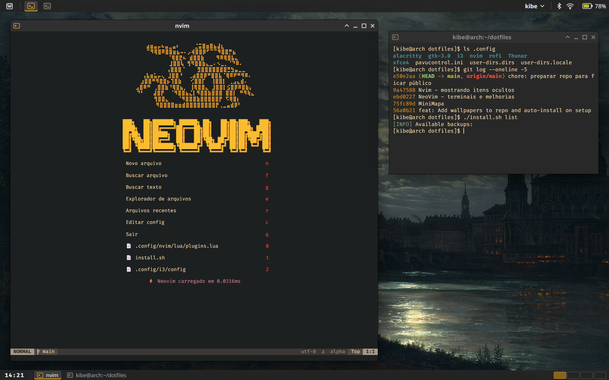

# dotfiles

Configurações pessoais de desktop Linux: **Arch Linux + XFCE + i3**, com Neovim, Alacritty e Rofi. Cada ambiente fica numa pasta própria e é linkado no `$HOME` com **GNU Stow**.



<sub>Prévia renderizada a partir das configs deste repositório (cores, fontes, dashboard e painéis).</sub>

## Instalação rápida

```bash
git clone https://github.com/1Kibe/dotfiles.git ~/dotfiles
cd ~/dotfiles
./install.sh
```

O script detecta a distro, pergunta quais ambientes ativar (`xfce` já vem marcado), instala os pacotes, pergunta se liga o servidor SSH (padrão: não) e cria os links. Rode como usuário normal: ele chama o `sudo` quando precisa.

Pode clonar em qualquer pasta, por exemplo `~/Projetos/dotfiles`. Só não mova a pasta depois de linkar (veja [Cuidados](#cuidados)).

<details>
<summary>Passo a passo do que o <code>install.sh</code> faz</summary>

1. Detecta a distro pelo `/etc/os-release` e escolhe a lista em `packages/` (`arch`, `fedora` ou `ubuntu`)
2. Pergunta os ambientes: `xfce` (padrão sim) e `hyprland` (padrão não). O `common` entra sempre
3. Instala os pacotes das seções `[common]` + ambientes escolhidos. No Arch usa o **pacman**, e os pacotes marcados com `aur:` vão pelo **paru** (instalado se faltar)
4. Ativa NetworkManager e Bluetooth e pergunta se deve ativar o `sshd`
5. Oferece dependências opcionais do Neovim (Java, PHP, Go, Rust, Nix), só no Arch
6. Configura o filtro git que mantém nomes de redes Wi-Fi fora dos commits
7. Cria os links com o `stow` (`common` + ambientes escolhidos)
8. Aplica as configurações do XFCE (temas, painéis, wallpaper), se o ambiente `xfce` foi escolhido

</details>

## Como funciona

Cada pasta de ambiente espelha o `$HOME`: `common/.config/nvim` vira `~/.config/nvim`. Como são links, **editar um arquivo no repositório já muda o sistema**, e guardar a mudança é só fazer commit.

| Pasta | Vira | Quando entra |
|---|---|---|
| `common/` | `~/.config/nvim`, `alacritty`, `rofi`, `wallpapers` | Sempre |
| `xfce/` | `~/.config/xfce4`, `i3`, `Thunar`, `gtk-3.0`, `pavucontrol.ini`, `user-dirs.*` | Ambiente `xfce` |
| `hyprland/` | `~/.config/hypr`, `quickshell` | Ambiente `hyprland` (ainda vazio, o script pula) |

Os pacotes seguem a mesma divisão: cada `packages/<distro>.txt` tem as seções `[common]`, `[xfce]` e `[hyprland]`.

## Comandos

| Comando | O que faz |
|---|---|
| `./install.sh` | Instala tudo: pacotes, serviços e links. Pergunta os ambientes |
| `./install.sh install xfce` | O mesmo, com os ambientes direto na linha de comando |
| `./install.sh link [ambiente...]` | Só cria ou atualiza os links. Use depois de um `git pull` |
| `./install.sh unlink [ambiente...]` | Remove os links. Sem ambiente, remove de todos |
| `./install.sh backup` | Salva o `~/.config` em `.backups/config_<data>.tar.gz` |
| `./install.sh list` | Lista os backups |
| `./install.sh restore [arquivo]` | Restaura um backup. Sem arquivo, mostra a lista e pergunta |

Dia a dia, depois de mudar alguma config:

```bash
cd ~/dotfiles
git add .
git commit -m "atualiza config do nvim"
git push
```

## O que vem configurado

### Neovim

Editor com LSP, autocomplete, formatação, árvore de arquivos, git e dashboard, no tema Gruvbox. O leader é `Espaço`. A cola de atalhos está em [`common/.config/nvim/atalhos.txt`](common/.config/nvim/atalhos.txt).

Os plugins são gerenciados pelo **lazy.nvim** e se instalam sozinhos: é só abrir o `nvim` e esperar na primeira vez.

<details>
<summary>Plugins</summary>

**Interface**
- `gruvbox.nvim` — tema Gruvbox dark (contraste hard)
- `alpha-nvim` — dashboard inicial com ASCII art
- `lualine.nvim` — statusline
- `bufferline.nvim` — abas de buffers
- `neominimap.nvim` — minimapa lateral
- `indent-blankline.nvim` — guias de indentação
- `which-key.nvim` — mostra os atalhos disponíveis

**Navegação e busca**
- `telescope.nvim` (+ `telescope-ui-select`) — busca fuzzy de arquivos/texto/buffers
- `neo-tree.nvim` — explorador de arquivos lateral
- `nvim-spectre` — buscar e substituir no projeto

**Código**
- `nvim-treesitter` — syntax highlighting
- `mason.nvim` / `mason-lspconfig.nvim` / `mason-tool-installer.nvim` — instala LSPs e formatters
- `nvim-lspconfig` — LSPs: `lua_ls`, `jdtls`, `ts_ls`, `html`, `cssls`, `eslint`
- `nvim-cmp` + `LuaSnip` — autocomplete e snippets
- `conform.nvim` — formatação de código
- `trouble.nvim` — lista de diagnósticos
- `nvim-autopairs`, `Comment.nvim`, `vim-visual-multi` — pares, comentários e múltiplos cursores

**Git e terminal**
- `gitsigns.nvim` — indicadores de git no gutter
- `vim-fugitive`, `neogit`, `diffview.nvim` — fluxo de git dentro do editor
- `toggleterm.nvim` — terminais flutuantes/integrados

</details>

<details>
<summary>Formatters (conform.nvim, <code>Espaço f</code>)</summary>

| Linguagem | Formatter |
|---|---|
| Lua | stylua |
| Python | ruff |
| C/C++ | clang-format |
| Rust | rustfmt |
| Go | gofumpt |
| Nix | alejandra |
| TOML | taplo |
| Java | google-java-format |
| PHP | php-cs-fixer |
| JS/TS/React | prettier |
| CSS/HTML/JSON/YAML/MD | prettier |
| Bash | shfmt |

</details>

<details>
<summary>Dependências opcionais</summary>

Alguns formatters e LSPs precisam de um runtime a mais. O `install.sh` pergunta quais instalar (só no Arch):

| Runtime | Para quê |
|---|---|
| **JDK (jdk-openjdk)** | LSP Java (jdtls) + google-java-format |
| **PHP** | php-cs-fixer |
| **Go** | gofumpt |
| **Rust (rustup)** | rustfmt + rust-analyzer |
| **Nix** | alejandra |

Depois de instalar, rode `:Mason` dentro do `nvim` para conferir os LSPs e formatters.

</details>

### XFCE

Dois painéis: em cima ficam menu, janelas abertas, sessão, área de notificação e bateria; embaixo, relógio, janelas abertas e áreas de trabalho. Tema GTK Adwaita-dark com ícones breeze-dark.

| Atalho | Ação |
|---|---|
| `Super+D` | Rofi (abrir aplicativo) |
| `Super+Espaço` | Alacritty |
| `Super+E` | Thunar |
| `Print` | Captura da tela inteira |
| `Shift+Print` | Captura de uma área |
| `Alt+Print` | Captura da janela |

<details>
<summary>Arquivos do XFCE versionados</summary>

- **xfce4-panel.xml** — posição e plugins dos painéis, configuração de cada widget
- **xfce4-desktop.xml** — wallpaper e ícones da área de trabalho
- **xsettings.xml** — tema GTK, ícones e fontes
- **xfwm4.xml** — tema e botões das janelas
- **xfce4-keyboard-shortcuts.xml** — todos os atalhos
- Screenshooter, Thunar, notificações e gerenciamento de energia

</details>

### i3

Window manager em mosaico, com `Super` como tecla principal. `Super+Enter` abre o terminal, `Super+D` abre o Rofi (igual ao XFCE), `Super+Shift+Q` fecha a janela, `Super+1` a `Super+0` trocam de área de trabalho e `Super+Shift+R` reinicia o i3. Junto com ele sobem o `nm-applet`, o `xss-lock` com `i3lock` (trava a tela ao suspender) e os programas de autostart, pelo `dex`.

### Outros

| Programa | Configuração |
|---|---|
| **Alacritty** | FiraCode Nerd Font 12, tema Gruvbox |
| **Rofi** | Tema gruvbox-dark |
| **Thunar** | Ação "Open Terminal Here" e atalhos próprios |
| **Pavucontrol** | Controle de áudio PulseAudio/PipeWire |
| **GTK 3** | Bookmarks do gerenciador de arquivos |

## Distros

| Distro | Pacotes | Links |
|---|---|---|
| Arch Linux e derivados (EndeavourOS, Manjaro...) | `packages/arch.txt`: pacman + AUR pelo paru | Sim |
| Fedora | `packages/fedora.txt` ainda vazio: só instala o `stow` | Sim |
| Ubuntu e Debian | `packages/ubuntu.txt` ainda vazio: só instala o `stow` | Sim |

As dependências opcionais do Neovim, por enquanto, só são oferecidas no Arch.

## Cuidados

- **Nomes de Wi-Fi no painel do XFCE.** O XFCE grava os nomes das redes no `xfce4-panel.xml`. Um filtro git (`tools/xfce-panel-clean.awk`, ligado pelo `install.sh`) tira isso antes de cada commit. Mesmo assim, revise o `git diff` antes do push.
- **Nada é apagado.** Se já existir um arquivo onde vai um link, ele é renomeado para `<nome>.bak`.
- **Não mova a pasta depois de linkar.** Para mover: `./install.sh unlink`, mova a pasta e rode `./install.sh link` no lugar novo.
- **Backups ficam fora do git.** A pasta `.backups/` está no `.gitignore`, porque um backup do `~/.config` pode ter tokens e cookies de outros programas.

## Referência

<details>
<summary>Estrutura completa das pastas</summary>

```
dotfiles/
├── common/.config/
│   ├── alacritty/alacritty.toml
│   ├── nvim/
│   │   ├── init.lua
│   │   ├── atalhos.txt
│   │   ├── lazy-lock.json
│   │   └── lua/
│   │       ├── dashboard.lua
│   │       └── plugins.lua
│   ├── rofi/config.rasi
│   └── wallpapers/
├── xfce/.config/
│   ├── i3/config
│   ├── gtk-3.0/bookmarks
│   ├── Thunar/
│   │   ├── accels.scm
│   │   └── uca.xml
│   ├── xfce4/
│   │   ├── helpers.rc
│   │   ├── help.rc
│   │   ├── xfce4-screenshooter
│   │   ├── desktop/
│   │   │   ├── accels.scm
│   │   │   └── icons.screen0.yaml
│   │   └── xfconf/xfce-perchannel-xml/   [painéis, temas, atalhos, wallpaper]
│   │       ├── xfce4-panel.xml
│   │       ├── xfce4-desktop.xml
│   │       ├── xfwm4.xml
│   │       ├── xsettings.xml
│   │       ├── xfce4-keyboard-shortcuts.xml
│   │       └── ...
│   ├── pavucontrol.ini
│   ├── user-dirs.dirs
│   └── user-dirs.locale
├── hyprland/
│   ├── README.md
│   └── .config/
│       ├── hypr/
│       └── quickshell/
├── packages/
│   ├── arch.txt
│   ├── fedora.txt                        [TODO]
│   └── ubuntu.txt                        [TODO]
├── assets/preview.png
├── tools/xfce-panel-clean.awk
├── install.sh
├── LICENSE
└── README.md
```

</details>

<details>
<summary>Migrando do layout antigo (antes da organização por ambiente)</summary>

Até a reorganização, as configs ficavam em `.config/` na raiz do repo, e o `install.sh` criava links `~/.config/<nome>` apontando para lá. Depois do `git pull` esses links ficam quebrados. Para trocar pelos links do `stow`:

```bash
cd ~/dotfiles
git pull
./install.sh link xfce
```

- Se o `git pull` reclamar de mudanças locais (o XFCE altera os XMLs o tempo todo), faça commit delas antes.
- O `link` apaga só os links que apontam para dentro do repo e recria tudo com o `stow`. Qualquer outro arquivo no caminho vira `<nome>.bak`.
- Arquivos que os programas gravaram em `.config/` pelos links antigos e nunca entraram no git (lançadores do painel, outros canais do xfconf, `settings.ini` do GTK) são movidos para o pacote novo, então nada do desktop some.
- Os wallpapers, que antes eram copiados para `~/.config/wallpapers`, viram `~/.config/wallpapers.bak` e podem ser apagados (o repo tem os mesmos arquivos).

</details>

## Próximos passos

- [x] Organizar em pastas por ambiente (`common/`, `xfce/`, `hyprland/`) com GNU Stow
- [ ] Hyprland + Quickshell personalizado em `hyprland/` (configs e seção `[hyprland]` de `packages/arch.txt`)
- [ ] Listas de pacotes para Fedora e Ubuntu (`packages/fedora.txt` e `packages/ubuntu.txt`, hoje só com as seções vazias)
- [ ] Dependências opcionais do Neovim fora do Arch

## Licença

MIT — veja [LICENSE](LICENSE).
